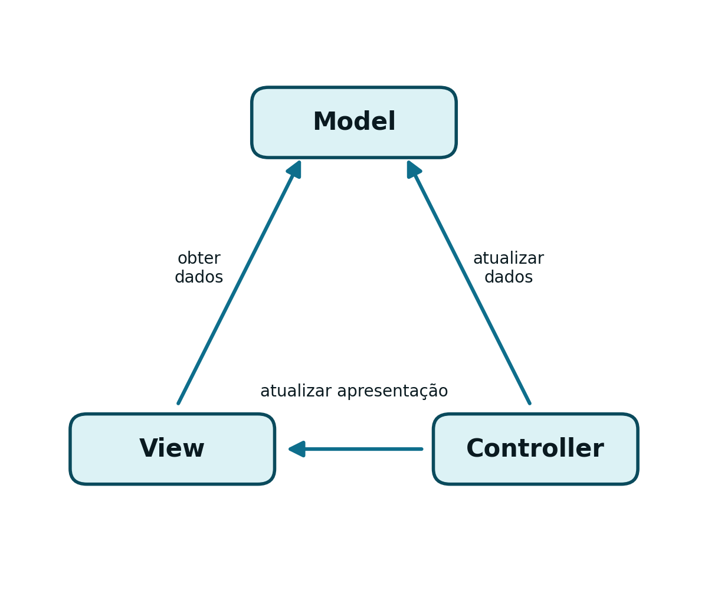
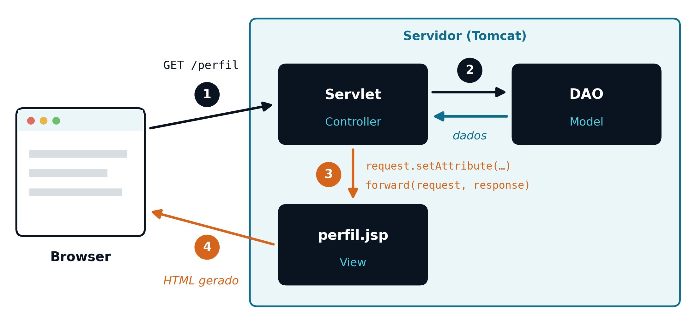
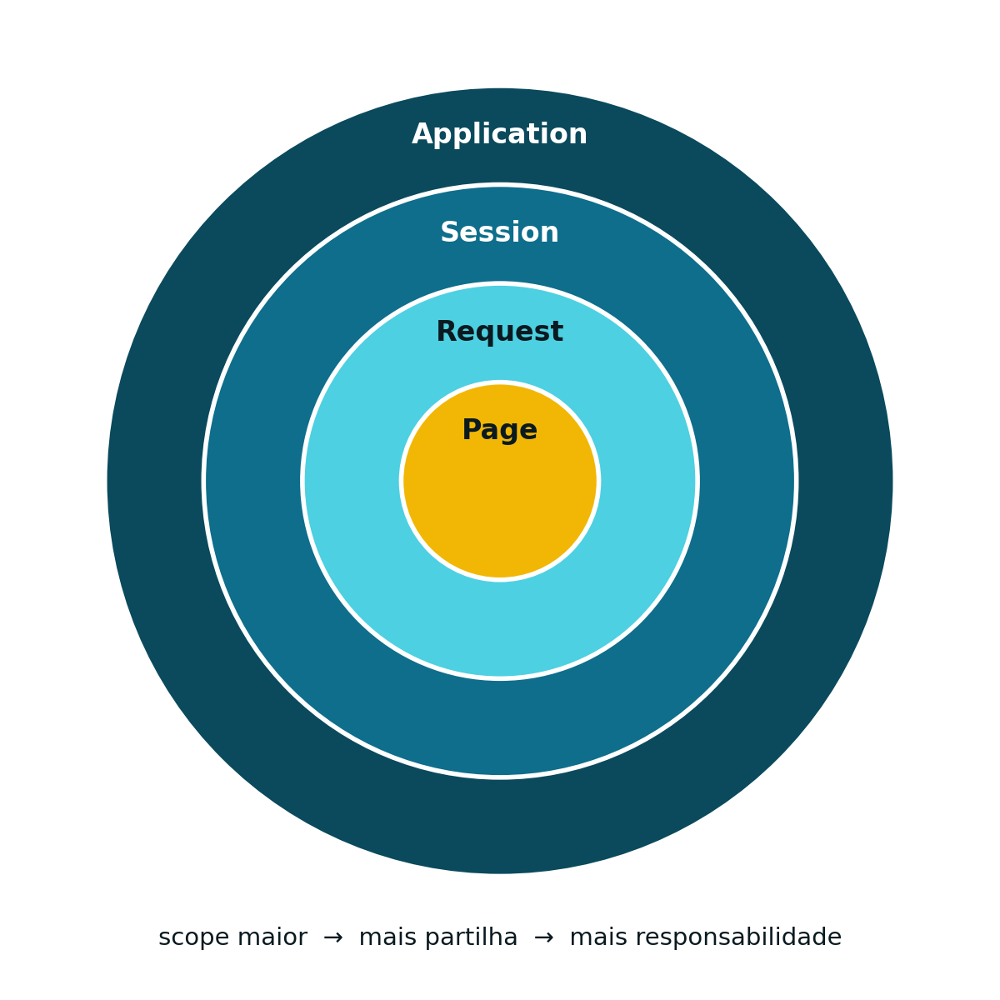

## HTTP é Sem Estado: o Problema {#sec-05-problema-estado}

O protocolo HTTP é *stateless* (ver [Capítulo 3](cap03.qmd)): cada pedido é independente, e o servidor não guarda, por si só, qualquer memória de pedidos anteriores. Não existe, ao nível do protocolo, nenhuma noção de "utilizador com sessão iniciada".

Isto levanta um problema prático imediato: se um utilizador se autentica num pedido, como é que um pedido seguinte, minutos depois, sabe que esse utilizador continua autenticado? A resposta passa por dois mecanismos complementares:

- ***Cookies***: um pequeno pedaço de informação guardado do lado do **cliente**, reenviado automaticamente pelo *browser* em cada pedido seguinte
- **`HttpSession`**: um objeto guardado do lado do **servidor**, associado a um identificador que o cliente devolve a cada pedido

## *Cookies* {#sec-05-cookies}

Um *cookie* é um par chave/valor guardado no *browser*. Quando o servidor envia um *cookie*, espera que o cliente o devolva em todos os pedidos HTTP seguintes, dirigidos ao mesmo domínio, implementando deste modo um mecanismo de identificação que contorna a natureza *stateless* do HTTP.

Distinguem-se dois tipos, consoante a sua persistência:

- **_Session cookies_**: mantidos pelo cliente apenas durante uma sessão de navegação (`setMaxAge(-1)`). Enquanto não se fechar a sessão, o cliente continua a identificar-se através do *cookie*. A partir do momento em que se fecha a sessão (por *logout* ou fechando o *browser*) o *cookie* é destruído.
- **_Permanent cookies_**: guardados de forma persistente, com um tempo de vida definido (`setMaxAge(60*60*24*30)` - o tempo é expresso em segundos, neste caso para 30 dias).

Criar um *cookie*:

```java
Cookie cookie = new Cookie("tema", "escuro");
cookie.setMaxAge(60 * 60 * 24 * 30); // permanent cookie: 30 dias
response.addCookie(cookie);          // o cookie é adicionado à resposta e enviado ao cliente
```

Ler um *cookie* recebido num pedido:

```java
Cookie[] cookies = request.getCookies();
String tema = null;

if (cookies != null) {                       // null se o pedido não trouxer cookies
    for (Cookie c : cookies) {
        if (c.getName().equals("tema")) {
            tema = c.getValue();
        }
    }
}
```

O método `getCookies()` devolve `null`, e não um vetor vazio, quando o pedido não traz nenhum *cookie*, pelo que a verificação `cookies != null` é obrigatória.

## Sessões (`HttpSession`) {#sec-05-sessoes-http}

Guardar estado do lado do servidor exige um objeto próprio para o efeito: a `HttpSession`. A diferença essencial em relação a um *cookie* está no sítio onde ficam os dados (@fig-05-cookie-vs-sessao): o *browser* guarda apenas um identificador, e é o servidor que guarda, associados a esse identificador, todos os dados da sessão. Os dados nunca saem do servidor, e o cliente não os pode ler nem alterar.

{#fig-05-cookie-vs-sessao width="90%"}

Uma sessão obtém-se, ou cria-se, a partir do pedido:

```java
HttpSession session = request.getSession();          // cria se não existir
HttpSession session = request.getSession(true);      // equivalente, explícito
HttpSession session = request.getSession(false);     // NUNCA cria; devolve null se não houver
```

Uma vez obtida, a sessão guarda e devolve informação através de atributos, e pode ser terminada explicitamente:

```java
session.setAttribute("email", "foo@fool.com");
String email = (String) session.getAttribute("email");
session.invalidate();                    // termina a sessão
session.setMaxInactiveInterval(1800);     // tempo de inatividade, em segundos
session.getId();                          // identificador da sessão (o JSESSIONID)
session.getAttributeNames();              // nomes de todos os atributos guardados
```

Falta uma peça: se HTTP não tem memória de pedidos anteriores, como é que o servidor sabe que dois pedidos sucessivos pertencem à mesma sessão? A resposta são, de novo, os *cookies*: por convenção, o identificador de sessão viaja num *cookie* chamado `JSESSIONID`, criado automaticamente pelo *Servlet Container* na primeira chamada a `getSession()`.

::: {.httpmsg}
JSESSIONID=22562577CE80EF3B1DAAA0E48F2B6392
:::

A @fig-05-jsessionid mostra o mecanismo completo, passo a passo:

1. O *browser* envia as credenciais (`POST /login`). Ainda não tem nenhum *cookie* deste servidor.
2. A *Servlet* chama `getSession()`, o contentor cria uma sessão nova com um identificador único e a resposta leva o cabeçalho `Set-Cookie: JSESSIONID=...`.
3. Num pedido seguinte (`GET /perfil`), o *browser* devolve automaticamente o *cookie* no cabeçalho `Cookie`. O contentor usa o identificador para encontrar a sessão certa entre todas as que guarda.
4. A *Servlet* lê os atributos dessa sessão e responde com os dados daquele utilizador.

{#fig-05-jsessionid width="90%"}

Quando o cliente não aceita *cookies*, existe uma alternativa: codificar o identificador de sessão diretamente na *URL*.

::: {.httpmsg}
http://localhost:8080/loja/perfil;jsessionid=829F8836C240B51DD2F074259F242833
:::

É boa prática chamar sempre `response.encodeURL(url)` ao construir uma *URL* de destino: se os *cookies* estiverem ativos, o método devolve a *URL* inalterada; se não estiverem, acrescenta automaticamente o `jsessionid`.

## Autenticação Baseada em Sessão {#sec-05-autenticacao-sessao}

Juntando os dois mecanismos anteriores, obtém-se o padrão clássico de autenticação por sessão. Depois de validar as credenciais, a `LoginServlet` cria uma sessão e guarda nela o identificador do utilizador:

```java
@WebServlet("/login")
public class LoginServlet extends HttpServlet {
    protected void doPost(HttpServletRequest request, HttpServletResponse response)
            throws ServletException, IOException {
        String utilizador = request.getParameter("utilizador");
        String palavraPasse = request.getParameter("palavra-passe");

        if (dao.validarCredenciais(utilizador, palavraPasse)) {
            HttpSession session = request.getSession(true);
            session.setAttribute("utilizador", utilizador);

            response.setContentType("text/plain; charset=UTF-8");
            response.getWriter().print("Bem-vindo, " + utilizador);
        } else {
            response.setStatus(HttpServletResponse.SC_UNAUTHORIZED);
            response.setContentType("text/plain; charset=UTF-8");
            response.getWriter().print("Utilizador ou palavra-passe inválidos");
        }
    }
}
```

Note-se que `dao` é uma instância de um *Data Access Object* (DAO), o objeto dedicado ao acesso a dados já referido no [Capítulo 4](cap04.qmd) (por exemplo, um `UtilizadorDAO`). Neste caso, é responsável por validar as credenciais recebidas: tipicamente consulta uma base de dados de utilizadores e devolve `true` ou `false` consoante o par utilizador/palavra-passe seja válido ou não.

Qualquer *endpoint* protegido verifica, no início do seu próprio `doGet()` ou `doPost()`, se existe uma sessão válida com esse atributo:

```java
HttpSession session = request.getSession(false);
if (session == null || session.getAttribute("utilizador") == null) {
    response.setStatus(HttpServletResponse.SC_UNAUTHORIZED);
    response.getWriter().print("Autenticação necessária");
    return;
}
// pedido autenticado: continuar o processamento normal
```

O logout resume-se a terminar a sessão:

```java
session.invalidate();
```

## O Padrão MVC com *Servlet* e JSP {#sec-05-mvc-jsp}

O [Capítulo 1](cap01.qmd) apresentou o padrão MVC a nível conceptual, e o [Capítulo 4](cap04.qmd) mostrou como uma *Servlet* funciona como Controller. As páginas construídas no [Capítulo 2](cap02.qmd) já desempenham o papel de View, mas são estáticas: o seu conteúdo não muda consoante o pedido. Esta secção mostra uma forma alternativa de construir a View, desta vez gerada dinamicamente do lado do servidor, a partir dos dados que o Controller lhe entrega.

{#fig-05-mvc-geral width="55%"}

Numa aplicação orientada à apresentação, a *Servlet* recebe o pedido e decide **o quê** mostrar, mas delega a **geração do HTML** propriamente dita a uma [*JavaServer Page*](https://jakarta.ee/specifications/pages/) (JSP). O Model, por sua vez, é uma classe Java comum (por exemplo, um *DAO*), independente de ambos.

A *Servlet* liga-se à JSP através de um `RequestDispatcher`: coloca os dados a mostrar num atributo do pedido, e encaminha (*forward*) o próprio pedido para a página:

```java
request.setAttribute("utilizador", utilizador);
request.getRequestDispatcher("/perfil.jsp").forward(request, response);
```

Um *forward* é uma passagem interna: a *Servlet* entrega o pedido a outro componente do mesmo servidor, sem o devolver ao *browser*. O percurso completo de um pedido está na @fig-05-servlet-jsp:

1. O *browser* pede `GET /perfil` e o pedido chega à *Servlet*.
2. A *Servlet* obtém os dados (através do DAO) e guarda-os no pedido, com `request.setAttribute(...)`.
3. A *Servlet* entrega à `perfil.jsp` o mesmo objeto `request` e o mesmo objeto `response` que recebeu.
4. A JSP lê os dados do `request` e escreve o HTML no `response`.
5. O *browser* recebe uma única resposta, e a barra de endereço continua a mostrar `/perfil`.

Tudo acontece dentro do servidor: existe um só pedido HTTP, e o *browser* não chega a saber que a JSP existiu. É por isso que os atributos colocados no pedido pela *Servlet* continuam disponíveis na JSP: os dois componentes trabalham sobre o mesmo objeto `request`.

{#fig-05-servlet-jsp width="90%"}

Uma JSP é um documento de texto que mistura dois tipos de conteúdo: HTML estático e elementos de *script* dinâmico. Na primeira vez que é pedida, o *Servlet Container* converte-a automaticamente numa classe *Servlet*, que passa a comportar-se, dali em diante, exatamente como qualquer outra *Servlet*, no papel de `Controller`.

## Um Exemplo Simples de JSP {#sec-05-exemplo-jsp}

```jsp
<%@ page language="java" contentType="text/html; charset=UTF-8" pageEncoding="UTF-8"%>

<% String utilizador = (String) request.getAttribute("utilizador"); %>

<!DOCTYPE html>
<html>
<head>
  <meta http-equiv="Content-Type" content="text/html; charset=UTF-8">
  <title>Uma Página JSP</title>
</head>
<body>
  <h1>Olá, <%= utilizador %>!</h1>
</body>
</html>
```

O bloco `<% ... %>` (*scriptlet*) contém código Java arbitrário; o bloco `<%= ... %>` (expressão) insere o valor de uma expressão Java diretamente no HTML gerado. É exatamente o atributo `utilizador`, colocado no pedido pela *Servlet* através de `request.setAttribute(...)`, que a JSP aqui recupera.

::: {.callout-tip}
## *Expression Language* (EL)

Os *scriptlets* são hoje considerados prática antiga, porque misturam código Java com HTML. Nas JSP atuais, a mesma linha escreve-se com a *Expression Language*, que procura o atributo pelo nome nos vários *scopes* (ver @sec-05-scopes), do mais restrito para o mais lato:

```jsp
<h1>Olá, ${utilizador}!</h1>
```
:::

## Ciclo de Vida e Objetos Implícitos {#sec-05-ciclo-vida-jsp}

O ciclo de vida de uma JSP segue o mesmo modelo da *Servlet* em que é convertida (ver [Capítulo 4](cap04.qmd)), com dois pormenores próprios:

- O contentor recompila a JSP automaticamente sempre que o ficheiro `.jsp` é alterado
- Em vez de `init()` e `destroy()`, a JSP oferece os métodos `jspInit()` e `jspDestroy()`

Outra diferença prática: dentro de uma JSP, um conjunto de objetos está disponível automaticamente, sem qualquer declaração prévia, chamados objetos implícitos:

| Objeto implícito | Tipo |
|---|---|
| `out` | `JspWriter` |
| `request` | `HttpServletRequest` |
| `response` | `HttpServletResponse` |
| `session` | `HttpSession` |
| `application` | `ServletContext` |
| `page` | `Object` |

Por causa do objeto implícito `out`, uma JSP nunca precisa de obter explicitamente um `PrintWriter`: usa-se `out` diretamente. Do mesmo modo, `request`, `session` e `application` dão acesso direto aos três *scopes* descritos a seguir.

## *Scopes*: Partilhar Informação Dentro do Servidor {#sec-05-scopes}

Tal como as *Servlets* podem partilhar informação com outros módulos através de atributos (ver [Capítulo 4](cap04.qmd)), esses atributos existem sempre dentro de um determinado âmbito, ou *scope*. Existem quatro classes de *scope*:

- ***Web context*** (ou *application context*): os dados são vistos por toda a aplicação, em todos os pedidos de todos os utilizadores (por exemplo, o endereço da base de dados)
- ***Session***: os dados pertencem a um utilizador e mantêm-se entre os pedidos desse utilizador (por exemplo, quem fez *login*)
- ***Request***: os dados existem só durante um pedido e perdem-se assim que a resposta é enviada (por exemplo, os dados que a *Servlet* passa à JSP)
- ***Page***: exclusivo de JSP, não é usado nesta UC

Todos os *scopes* seguem a mesma interface: métodos `setAttribute`/`getAttribute`, e `getAttributeNames()` para listar tudo o que lá está guardado.

**Web context**, partilhado por toda a aplicação:

```java
ServletContext context = request.getServletContext();
context.setAttribute("dbHost", "localhost");
String dbHost = (String) context.getAttribute("dbHost");
```

**Session**, já apresentado, partilhado apenas pelo mesmo utilizador:

```java
HttpSession session = request.getSession();
session.setAttribute("email", "foo@fool.com");
String email = (String) session.getAttribute("email");
```

**Request**, o mais restrito de todos, partilhado apenas entre módulos que processam o mesmo pedido (por exemplo, entre uma *Servlet* e a JSP para a qual reencaminha):

```java
request.setAttribute("email", "foo@fool.com");
String email = (String) request.getAttribute("email");
```

Os quatro *scopes* formam uma hierarquia de inclusão, do mais lato ao mais restrito: *Application* contém *Session*, que contém *Request*, que contém *Page*. Quanto maior o *scope*, mais partilhada fica a informação, e maior a responsabilidade de a gerir corretamente (por exemplo, de a remover quando deixa de ser necessária).

{#fig-05-scopes-comparacao width="60%"}

::: {.callout-note}
## *Scopes* não se instanciam

Os objetos de *scope* (`ServletContext`, `HttpSession`, `ServletRequest`) são fornecidos automaticamente pelo contentor. Nunca se cria uma instância nova com `new`: obtêm-se a partir do pedido. O método `getServletContext()` devolve sempre o mesmo contexto, que existe enquanto a aplicação está a correr; o método `getSession()` devolve a sessão existente ou, se ainda não houver nenhuma, cria uma nova.
:::
