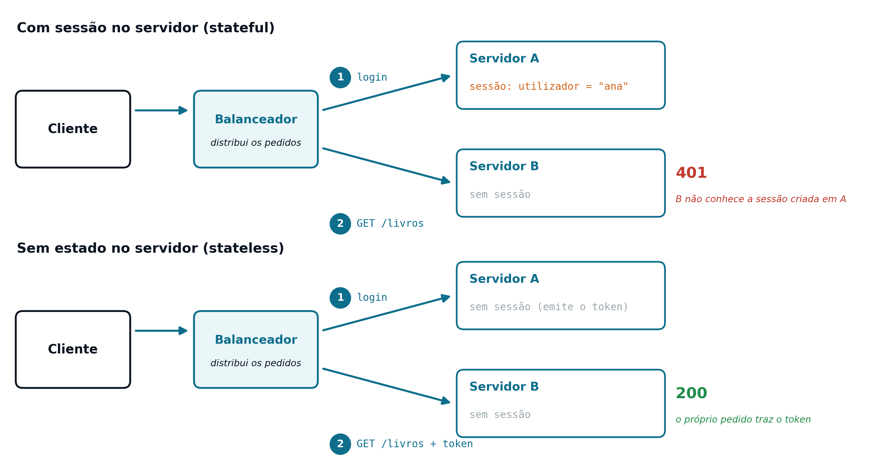

## O Problema: Aplicações que Precisam de Comunicar {#sec-07-problema}

Até aqui, o servidor foi sempre pensado a partir de um único tipo de cliente: um *browser*, a pedir páginas HTML para um utilizador humano ler. Mas um servidor raramente serve só esse tipo de cliente. Uma aplicação móvel, outro servidor, um *script* de integração, ou o próprio JavaScript a correr no *browser* (ver [Capítulo 8](cap08.qmd)) podem também precisar de aceder à mesma informação, sem nenhum deles precisar, ou querer, receber uma página HTML pronta a mostrar.

O HTML é um formato pensado para apresentação: mistura os dados com a estrutura e a forma como esses dados devem ser mostrados. Um programa que só precise dos dados (por exemplo, o título e o autor de um livro) teria de "desmontar" o HTML para lá chegar, o que é frágil e depende de pormenores de apresentação que nada têm a ver com a informação em si. Faz falta uma forma de expor os mesmos dados para que qualquer programa, e não só um *browser* com um humano a olhar para ele, os consiga consumir diretamente.

## O Que é um *Web Service* {#sec-07-webservice}

Um *Web Service* é um componente de *software* acessível através da rede, tipicamente por HTTP, que expõe funcionalidade ou dados num formato pensado para ser consumido por outros programas, e não por um humano a ler diretamente. Ao contrário de uma página *Web*, um *Web Service* não gera apresentação: devolve apenas os dados, organizados numa estrutura conhecida, e é o cliente que decide o que fazer com eles.

Este desacoplamento é o que permite ao mesmo servidor responder, com a mesma lógica, a pedidos vindos de origens completamente diferentes: uma aplicação móvel, um *front-office* em JavaScript, ou outro servidor. Todos recebem os mesmos dados, na mesma estrutura, e cada um decide como os apresentar (ou se sequer os apresenta).

## SOAP e REST: Duas Abordagens {#sec-07-soap-rest}

Historicamente, existiram duas abordagens principais para construir *Web Services*:

**SOAP** (*Simple Object Access Protocol*)
: Um protocolo formal, baseado em XML, com uma estrutura rígida de mensagem (o *envelope* SOAP) e um contrato descrito à parte, num documento *WSDL*. É verboso e exige ferramentas específicas para gerar e consumir esse contrato, mas oferece garantias formais fortes. É usado sobretudo em sistemas empresariais legados, com requisitos rigorosos de transação e segurança.

**REST** (*Representational State Transfer*)
: Um estilo arquitetural, e não um protocolo formal, que usa diretamente o HTTP como transporte e como contrato: os métodos, os códigos de estado e os cabeçalhos já apresentados nos [Capítulos 3](cap03.qmd) e [4](cap04.qmd) são, eles próprios, o vocabulário da API. É mais leve e mais simples de testar, e é hoje a abordagem dominante em aplicações *Web* e móveis. É a única tratada em pormenor nesta UC.

## REST: os Princípios de Fielding {#sec-07-rest-principios}

O termo REST foi cunhado por Roy Fielding, em 2000, para descrever o estilo arquitetural que já estava, na prática, implícito no desenho da própria *Web*. Um serviço REST segue um conjunto de princípios:

- **Cliente-servidor**: as responsabilidades estão separadas; o cliente não precisa de saber como os dados são armazenados, e o servidor não precisa de saber como são apresentados.
- **Sem estado** (*stateless*): cada pedido contém toda a informação necessária para ser processado, sem depender de memória de pedidos anteriores no servidor (ver @sec-07-stateful-stateless).
- **Interface uniforme**: os recursos são manipulados sempre da mesma forma, através dos métodos e códigos de estado do próprio HTTP, sem inventar um vocabulário próprio para cada API.
- **Recursos e representações**: tudo o que a API expõe é modelado como um recurso, identificado por um *URL*, com uma ou mais representações possíveis (tipicamente JSON).
- **Cacheável**: uma resposta pode indicar se pode, ou não, ser guardada em *cache*, para evitar pedidos repetidos desnecessários.

Nem todas as APIs que se dizem "REST" respeitam todos estes princípios com rigor. Na prática, "REST" tornou-se um termo genérico para "API sobre HTTP, orientada a recursos, tipicamente com JSON", e é esse o sentido usado ao longo desta UC.

## Arquitetura Orientada a Recursos {#sec-07-recursos}

O princípio mais visível do REST é pensar a API em torno de **recursos**, e não de ações. Um recurso é qualquer coisa que possa ser identificada e manipulada (um livro, um autor, uma encomenda) e é identificado por um *URL*, nunca por um nome de função.

Um desenho que não segue este princípio aproxima-se antes de um estilo *RPC* (*Remote Procedure Call*), em que o *URL* nomeia uma operação:

::: {.httpmsg}
GET /obterLivro?id=12\
GET /removerLivro?id=12
:::

Um desenho orientado a recursos usa o próprio *URL* para identificar o recurso, e deixa o método HTTP (ver [Capítulo 3](cap03.qmd)) indicar a operação a realizar sobre ele:

::: {.httpmsg}
GET /livros/12 → obter o livro 12\
DELETE /livros/12 → remover o livro 12
:::

A vantagem não é só estética: torna a API previsível. Conhecido o padrão `/livros/{id}`, sabe-se de imediato como obter, atualizar ou remover qualquer livro, sem ser preciso decorar um nome de função diferente para cada operação. O mesmo padrão aplica-se a qualquer outro recurso: `/autores/3`, `/encomendas/5`.

## Os Métodos HTTP como Contrato da API {#sec-07-metodos-contrato}

Numa API REST, os métodos HTTP deixam de ser só "a forma como o pedido chega" (ver [Capítulo 3](cap03.qmd)) e passam a ser o próprio contrato da API: o significado de cada método, aplicado a um recurso, é sempre o mesmo.

| Método | Exemplo | Operação | Idempotente? |
|---|---|---|---|
| `GET` | `GET /livros/12` | Ler o recurso | Sim |
| `POST` | `POST /livros` | Criar um novo recurso | Não |
| `PUT` | `PUT /livros/12` | Atualizar ou substituir o recurso | Sim |
| `DELETE` | `DELETE /livros/12` | Remover o recurso | Sim |

Um método diz-se **idempotente** quando repeti-lo várias vezes tem exatamente o mesmo efeito que executá-lo uma única vez. `DELETE /livros/12` remove o livro 12; repetir o mesmo pedido não remove "mais nada", e o resultado final é idêntico. Já `POST /livros` cria um livro novo a cada chamada, e por isso não é idempotente: repetir o pedido cria vários livros, e não um só. Esta propriedade importa sobretudo em redes pouco fiáveis. Um cliente que não tem a certeza de que um pedido `PUT` ou `DELETE` chegou ao destino pode repeti-lo em segurança; com um `POST` não o pode fazer, sob pena de duplicar o recurso criado.

::: {.callout-note}
## `POST` + `operation` como alternativa aos métodos HTTP "puros"

Na prática, é comum encontrar APIs que não seguem a semântica "pura" dos métodos HTTP apresentada acima (`POST` para criar, `PUT` para atualizar, `DELETE` para remover). Uma alternativa pragmática, usada sobretudo quando só é possível emitir pedidos `GET` e `POST` (como a partir de um formulário HTML simples, sem JavaScript, ver [Capítulo 2](cap02.qmd)), é concentrar as operações de escrita num único *endpoint*, recebido sempre por `POST`, e distinguir a operação pretendida através de um parâmetro adicional, como `operation` (`insert`, `update`, `delete`).

Esta solução funciona, mas afasta-se do desenho REST mais convencional: um único *endpoint* deixa de corresponder diretamente a um recurso e a um método, e aproxima-se antes de um estilo *RPC* sobre HTTP. Numa API pensada para ser consumida por JavaScript, que pode emitir pedidos `PUT` e `DELETE` sem qualquer limitação (ver [Capítulo 8](cap08.qmd)), a alternativa mais próxima do REST é dividir esse *endpoint* em vários, um por método HTTP (por exemplo, `PUT /livros/{id}` para atualizar e `DELETE /livros/{id}` para remover).
:::

## O Contrato REST: a Semântica do HTTP {#sec-07-contrato-http}

No SOAP, o contrato é explícito: para saber como chamar um serviço, é preciso ler o documento *WSDL* que o descreve. No REST, o contrato é implícito: já está definido pelo próprio HTTP, completado por algumas convenções. Para além dos métodos, duas peças do HTTP fazem parte deste contrato:

- **Os códigos de estado** dizem ao cliente o que aconteceu ao pedido, sem ser preciso ler o corpo da resposta.
- **Os cabeçalhos** transportam os metadados: o formato do corpo (`Content-Type`), o tamanho, ou a identificação de quem faz o pedido.

Os códigos de estado mais usados numa API REST são estes (ver [Capítulo 3](cap03.qmd)):

| Código | Significado numa API REST | Exemplo |
|---|---|---|
| `200 OK` | O pedido correu bem; o corpo traz o resultado | `GET /livros/12` |
| `201 Created` | O recurso foi criado | `POST /livros` |
| `400 Bad Request` | Os dados enviados são inválidos | `POST /livros` sem título |
| `401 Unauthorized` | O pedido não está autenticado | qualquer pedido protegido, sem autenticação |
| `404 Not Found` | O recurso não existe | `GET /livros/99`, se não houver livro 99 |

Um cliente que peça um livro que não existe envia este pedido:

::: {.httpmsg}
GET /livros/99 HTTP/1.1\
Host: exemplo.pt
:::

e recebe uma resposta cujo significado se percebe só pela primeira linha:

::: {.httpmsg}
HTTP/1.1 404 Not Found
:::

Quem percebe HTTP percebe a API: o mesmo conhecimento serve para qualquer API REST, sem ser preciso aprender um contrato novo para cada uma.

## JSON como Representação de um Recurso {#sec-07-json-representacao}

Um recurso pode ter mais do que uma representação possível: o mesmo livro poderia, em teoria, ser devolvido em JSON, em XML, ou em qualquer outro formato, consoante o que o cliente pedir. Na prática, e ao longo desta UC, a representação usada é sempre [JSON](https://www.json.org/), um formato leve, fácil de ler e independente da linguagem de programação (o formato tradicionalmente associado ao SOAP é o XML, mais verboso e menos direto de gerar e interpretar em JavaScript).

A resposta a `GET /livros/12` é, por exemplo, esta representação do livro:

```json
{"id": 12, "titulo": "Os Maias", "autor": "Eça de Queirós"}
```

O cabeçalho `Content-Type: application/json` (ver [Capítulo 4](cap04.qmd)) é o que informa o cliente de que é esta a representação escolhida para a resposta. Numa API REST não se transferem objetos nem páginas, mas sim representações do estado de cada recurso.

## De uma Aplicação Web a um Serviço REST {#sec-07-de-web-a-rest}

A infraestrutura por trás de um serviço REST não é nova: continua a ser uma *Servlet*, mapeada a um *URL* através de `@WebServlet` (ver [Capítulo 4](cap04.qmd)), a receber um pedido HTTP e a devolver uma resposta. O que muda é **o que** essa resposta contém, e **para quem** é pensada.

Numa aplicação orientada à apresentação (ver [Capítulos 1](cap01.qmd) e [5](cap05.qmd)), a *Servlet* devolve HTML, pensado para um humano ler diretamente no *browser*. Numa API REST, a mesma *Servlet* devolve JSON, pensado para ser interpretado por código: outro servidor, uma aplicação móvel, ou o JavaScript do próprio *browser* (ver [Capítulo 8](cap08.qmd)). A *View*, no sentido clássico do MVC (ver [Capítulo 1](cap01.qmd)), deixa de existir do lado do servidor: é o cliente, seja ele qual for, quem decide como (ou se) apresenta os dados recebidos.

{#fig-07-mvc-vs-rest width="90%"}

## *Stateful* vs. *Stateless* {#sec-07-stateful-stateless}

O [Capítulo 5](cap05.qmd) apresentou um modelo com estado (*stateful*): o servidor guarda, na `HttpSession`, informação sobre cada utilizador autenticado, e cada pedido seguinte é interpretado à luz dessa memória. Um serviço **sem estado** (*stateless*) segue o princípio oposto: o servidor não guarda memória nenhuma entre pedidos, e cada pedido tem de trazer, em si próprio, toda a informação necessária para ser processado, incluindo, se for preciso, a prova de que quem o faz está autenticado.

Isto não significa que a aplicação, no seu todo, deixe de ter dados persistentes: a base de dados continua a guardar livros, autores e encomendas. Significa apenas que o **servidor de aplicações**, em si, não guarda nenhuma informação de sessão sobre quem está a fazer cada pedido, entre um pedido e o seguinte.

## Porque a Ausência de Estado Importa {#sec-07-porque-stateless-importa}

A limitação do modelo com estado só se torna visível quando existe mais do que um servidor a atender pedidos (vários Tomcats, cada um com a mesma aplicação instalada; não confundir com instâncias de uma *Servlet*, que são sempre uma só por Tomcat, ver [Capítulo 4](cap04.qmd)), uma situação comum em qualquer aplicação com necessidade real de escala. Os pedidos chegam primeiro a um **balanceador** (*load balancer*), que os distribui pelos vários servidores. O percurso de dois pedidos seguidos mostra onde está o problema:

1. O utilizador faz *login*; o balanceador envia o pedido para o servidor A, que cria a sessão na sua memória.
2. O pedido seguinte, `GET /livros`, é enviado pelo balanceador para o servidor B.
3. O servidor B não tem, na sua memória, nenhuma sessão correspondente: o utilizador aparece como não autenticado (`401`), apesar de ter acabado de fazer *login*.

{#fig-07-instancias width="95%"}

Um serviço sem estado não sofre deste problema: como nenhum servidor guarda memória de ninguém, qualquer um deles pode responder a qualquer pedido. Esta propriedade é o que torna possível distribuir os pedidos por vários servidores sem qualquer coordenação entre eles, tema retomado em pormenor no [Capítulo 8](cap08.qmd).

## Monólito e Microsserviços {#sec-07-monolito-microsservicos}

A ausência de estado tem consequências na forma como uma aplicação é organizada. Num **monólito**, a aplicação é uma única unidade de instalação, frequentemente com estado (a sessão vive na memória do servidor), e só se consegue escalar por inteiro. Numa arquitetura de **microsserviços**, a aplicação é repartida em serviços pequenos e independentes, que comunicam entre si por APIs REST, sem estado e com autenticação por *token*, e cada um pode escalar isoladamente. A ausência de estado é o que torna possível repartir uma aplicação por vários servidores e por vários serviços.

## REST e RESTful {#sec-07-rest-restful}

**REST** é um estilo arquitetural: sem estado, orientado a recursos e com uma interface uniforme. Uma **API RESTful** é uma API que afirma seguir esse estilo. Como a ausência de estado faz parte da própria definição de REST, uma API que guarde a sessão do utilizador no servidor não é totalmente RESTful.

Fica, por isso, uma pergunta em aberto: se o servidor não guarda estado nenhum, como sabe, a cada pedido, quem é o utilizador? A resposta, a autenticação por *token*, é o tema do [Capítulo 8](cap08.qmd).
