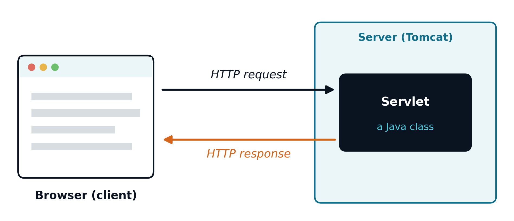

## The Jakarta EE Platform {#sec-04-jakarta-ee-en}

With the Frontend built ([Chapter 2](cap02.qmd)) and the Middleware detailed ([Chapter 3](cap03.qmd)), the third piece identified in [Chapter 1](cap01.qmd) is still missing: the Backend, which actually receives HTTP requests and answers them. It is the subject of this chapter and of the ones that follow.

[*Jakarta EE*](https://jakarta.ee/) (formerly known as *Java EE*, until it was renamed in 2019; the current version is *Jakarta EE* 11, from June 2025) is a platform that provides a set of ready-to-use services and *APIs* to deal with the problems common to any Web application (see [Chapter 1](cap01.qmd)), freeing developers to concentrate on the application's business logic.

The platform is based on the Java language and on the *Java Virtual Machine* (JVM), which means that any component written for *Jakarta EE* benefits from the portability and automatic memory management already known from the language.

## Layered Architecture {#sec-04-layered-architecture-en}

The *Jakarta EE* platform organises an application according to a distributed model in several layers (*tiers*), each with a well-defined role and typically installed on different machines:

| Layer | Where it lives | Typical components |
|---|---|---|
| *Client Tier* | Client machine | Web pages (browser), client applications |
| *Web Tier* | *Jakarta EE* server | *Servlets*, *JavaServer Pages*, *Web Services* |
| *Business Tier* | *Jakarta EE* server | *Enterprise Beans* (business logic) |
| *EIS Tier* (*Enterprise Information System*) | Database server | Databases, enterprise information systems |

This separation into layers allows each component to evolve relatively independently of the others: changing the database does not require rewriting the business logic, and changing the client interface does not require changing the server.

{#fig-04-jakarta-ee-architecture-en width="85%"}

::: {.callout-note}
## Tomcat is not a full Jakarta EE server

[*Apache Tomcat*](https://tomcat.apache.org/), used throughout this course, is a *Servlet Container*: it implements only the *Web Tier* (Servlets, JSP). It does not support *Enterprise Beans* or the *Business Tier* as such, unlike a full *Jakarta EE* application server (for example, *WildFly*, *WebSphere* or *GlassFish*). In practice, this means that the business logic which, in the formal architecture, would belong to the *Business Tier* is implemented here directly in ordinary Java classes, not in *Enterprise Beans*.
:::

## Why Servlets? {#sec-04-why-servlets-en}

Implementing, from scratch, a Java program able to answer HTTP requests would mean solving, alone, a set of problems common to any Web server: interpreting the HTTP message received, managing several connections at the same time (each in its own *thread*), controlling the life cycle of the instances in memory, and packaging all of this in a format that an application server knows how to install and start.

A [*Servlet*](https://jakarta.ee/specifications/servlet/) is a Java class that runs inside a *Servlet Container* (for example, *Apache Tomcat*) and automatically receives all this work already done:

- Interpretation (*parsing*) of the HTTP request
- Management of *threads*, one per request
- Management of the *Servlet*'s own life cycle
- Its own *deployment* model, packaged in a `.war` file (*Web Application Archive*)

In the layered architecture presented above, the *Servlet Container* corresponds to the *Web Tier*: that is where *Servlets* live, between the client and the business layer.

{#fig-04-servlet-http-en width="80%"}

## The Life Cycle of a Servlet {#sec-04-lifecycle-en}

When a request is routed to a *Servlet*, the container always follows the same sequence (@fig-04-servlet-lifecycle-en):

1. If there is no instance of that *Servlet* in memory yet, the container loads the class, creates an instance and calls the `init()` method
2. For each request received, the container invokes the `service()` method, which dispatches to `doGet()`, `doPost()` or another method depending on the HTTP verb used, passing it the `request` and `response` objects
3. If the container needs to remove the *Servlet* (for example, when the server shuts down), it invokes the `destroy()` method

{#fig-04-servlet-lifecycle-en width="95%"}

## One Instance, Many *Threads* {#sec-04-threads-en}

The life cycle has an important consequence: there is **a single instance** of each *Servlet* in memory, even if N clients are using the same service at the same time. Each request is handled by a different *thread*, but all these *threads* share the same instance (@fig-04-servlet-threads-en).

{#fig-04-servlet-threads-en width="90%"}

::: {.callout-warning}
## Beware of shared state

Never store data from a specific request in instance attributes of the *Servlet*: since the instance is shared by all *threads*, one request may read or overwrite data from another request in progress. Local variables, declared inside `doGet()` or `doPost()`, are safe, because each *thread* has its own copy.

**WRONG:** the name is kept in an attribute, shared by all requests

```java
public class PessoaServlet extends HttpServlet {
    private String nome;                            // a single attribute for all threads

    protected void doGet(HttpServletRequest request, HttpServletResponse response) throws IOException {
        nome = request.getParameter("nome");        // 1 stores "joao"; 2, at the same time, "maria"
        response.getWriter().print("Olá, " + nome); // request 1 may answer "Olá, maria"
    }
}
```

**RIGHT:** the name is kept in a local variable, one copy per *thread*

```java
    protected void doGet(HttpServletRequest request, HttpServletResponse response) throws IOException {
        String nome = request.getParameter("nome"); // each request has its own variable
        response.getWriter().print("Olá, " + nome); // each request answers with its own name
    }
```
:::

## From the HTTP Message to the Java Method {#sec-04-http-to-servlet-mapping-en}

A *Servlet* is bound to a *URL* through the `@WebServlet` annotation, which maps a path to the class that will handle it:

```java
@WebServlet("/pessoa")
public class PessoaServlet extends HttpServlet {
    // ...
}
```

A client request to `http://localhost:8080/pessoa` is thus routed to the `PessoaServlet` class. The container discovers this annotation when the application is installed (*deployment*). The same binding could be declared in the `web.xml` file, which is still found in older projects. From the elements of the HTTP message received (see [Chapter 3](cap03.qmd)), the container automatically builds the request object; the complementary response object is the one the Servlet uses to build the outgoing message. The elements of each message correspond to specific methods of these two objects (@fig-04-http-request-server-en):

{#fig-04-http-request-server-en width="100%"}

The following table summarises the most used methods:

| HTTP element | Access in Java | When it is used |
|---|---|---|
| Request headers | `request.getHeader(name)` | Always, whatever the type of request |
| Parameters (*query string* of a `GET`, or `application/x-www-form-urlencoded` body of a `POST`) | `request.getParameter(name)` | Traditional HTML forms (see [Chapter 2](cap02.qmd)), in a presentation-oriented application |
| Raw request body (typically JSON) | `request.getInputStream()` | REST *web services* (see [Chapter 7](cap07.qmd)): the body is not in `application/x-www-form-urlencoded` format, so `getParameter()` does not interpret it, and the JSON has to be read and interpreted manually |
| Writing the response | `response.getWriter()` or `response.getOutputStream()` | Always, whatever the type of response |

For example, for a `GET /pessoa?nome=joao&idade=22` request:

```java
protected void doGet(HttpServletRequest request,
                     HttpServletResponse response) throws IOException {
    String nome = request.getParameter("nome");        // "joao"
    String idadeTexto = request.getParameter("idade"); // "22": always arrives as a String
    if (nome == null || idadeTexto == null) {          // missing parameter: null
        response.getWriter().print("Faltam parâmetros");
        return;
    }
    int idade = Integer.parseInt(idadeTexto);          // 22: now it is a number
    response.getWriter().print(nome + " tem " + idade + " anos");
}
```

Two precautions follow from this example. First, `getParameter()` returns `null` when the parameter was not sent in the request, and that case has to be handled before the value is used. Second, it always returns a `String`, even if the value is a number: the age arrives as `"22"` and has to be converted with `Integer.parseInt(...)` before it can be used as a number.

The same data can arrive through an HTML form sent by `POST`:

```html
<form action="pessoa" method="post">
    <input type="text"   name="nome">
    <input type="number" name="idade">
    <button type="submit">Enviar</button>
</form>
```

In this case, the browser sends the fields in the request body, in the format `nome=joao&idade=22`, and the `name` attribute of each field becomes the name of the parameter on the *Servlet* side. The request is handled by `doPost()`, but reading the parameters is exactly the same:

```java
protected void doPost(HttpServletRequest request,
                      HttpServletResponse response) throws IOException {
    request.setCharacterEncoding("UTF-8");             // before reading the parameters
    String nome = request.getParameter("nome");        // the same method as in GET
    String idadeTexto = request.getParameter("idade");
    // ... the rest is the same as doGet()
}
```

The call to `request.setCharacterEncoding("UTF-8")` must be made before reading any parameter: without it, a name with accents, such as *João*, may arrive garbled at the *Servlet*. The `request.getCharacterEncoding()` method returns the encoding the request is using.

The `getParameter()` method returns a single value. When the same name appears several times in the request, as happens with a group of *checkboxes* or a multiple-choice list (`cor=azul&cor=verde`), `getParameter("cor")` does not fail, but returns only the first value, `"azul"`. For these cases, the `request` object has three plural methods:

- `getParameterValues(name)` returns a `String[]` with all the values of that name (`{"azul", "verde"}`), or `null` if the parameter does not exist;
- `getParameterNames()` returns the names of all the parameters received, which is useful when it is not known in advance which fields come in the request;
- `getParameterMap()` returns a map (`Map<String, String[]>`) from each name to all its values, to go through the parameters in one go.

```java
String[] cores = request.getParameterValues("cor");   // {"azul", "verde"}
if (cores != null) {
    for (String cor : cores) {
        // handle each chosen colour
    }
}
```

## Content-Type and the Shape of the Response {#sec-04-content-type-en}

Before writing anything to the response, it is essential to set its `Content-Type`: this header tells the client how to interpret the bytes that follow, either as an HTML page or as [JSON](https://www.json.org/) data. The order matters: `setContentType()` must be called **before** `getWriter()`, because that is the moment the *writer* fixes the character encoding, which is why it is worth stating `charset=UTF-8`, so that accented characters reach the client intact.

With the same data as in the previous examples (`nome` and `idade`), a presentation-oriented application answers with HTML, which the browser shows as a page (*joao tem 22 anos*):

```java
response.setContentType("text/html; charset=UTF-8");
PrintWriter out = response.getWriter();
out.println("<html><body>");
out.println("<p>" + nome + " tem " + idade + " anos</p>");
out.println("</body></html>");
```

A service-oriented application answers with JSON, which a client program receives as data (`{"nome": "joao", "idade": 22}`):

```java
response.setContentType("application/json; charset=UTF-8");
PrintWriter out = response.getWriter();
String json = """
    {
      "nome": "%s",
      "idade": %d
    }
    """.formatted(nome, idade);

out.print(json);
```

It is the same data, for people (HTML) or for programs (JSON). Without a library dedicated to generating JSON, the most direct approach is to use a text block (delimited by `"""`, available since Java 15), which avoids escaping the quotes, and the `formatted()` method, which replaces `%s` and `%d` with the values. Note that the age, being a number, goes into the JSON without quotes (`%d`). This construction is fine for simple values: a `nome` containing quotes would make the JSON invalid, so, for arbitrary data, a JSON library should be used.

To set the status code of the response (see [Chapter 3](cap03.qmd)), the `HttpServletResponse` class provides a constant for each code, avoiding "magic" numbers directly in the code:

| HTTP code | Java constant |
|---|---|
| `200` | `HttpServletResponse.SC_OK` |
| `201` | `HttpServletResponse.SC_CREATED` |
| `400` | `HttpServletResponse.SC_BAD_REQUEST` |
| `401` | `HttpServletResponse.SC_UNAUTHORIZED` |
| `403` | `HttpServletResponse.SC_FORBIDDEN` |
| `404` | `HttpServletResponse.SC_NOT_FOUND` |
| `500` | `HttpServletResponse.SC_INTERNAL_SERVER_ERROR` |

Codes `401` and `403` differ in identity: `401` means the request is not authenticated (it is not known who it is), and `403` that it is authenticated but has no permission for this resource (it is known who it is, and they may not).

If the *Servlet* does not set any code, the container answers `200 OK`. That is why the `doGet()` example shown earlier, when parameters are missing, is incomplete: it writes "Faltam parâmetros", but the response tells the client that everything went well. A client error should carry the right code, `400 Bad Request`, so that a client program detects it without having to interpret the text of the response:

```java
if (nome == null || idadeTexto == null) {
    response.setStatus(HttpServletResponse.SC_BAD_REQUEST);  // 400
    response.getWriter().print("Faltam parâmetros");
    return;
}
```

::: {.callout-note}
## What if the age is not a number?

If the request carries `idade=abc`, `Integer.parseInt("abc")` throws an exception (`NumberFormatException`). If the *Servlet* does not handle it, the container answers `500 Internal Server Error`: the error was the client's, but the response blames the server. The right approach is to catch the exception and also answer with `400 Bad Request`:

```java
int idade;
try {
    idade = Integer.parseInt(idadeTexto);
} catch (NumberFormatException e) {
    response.setStatus(HttpServletResponse.SC_BAD_REQUEST);  // 400
    response.getWriter().print("A idade tem de ser um número");
    return;
}
```
:::

## Where the Data Lives: the DAO {#sec-04-dao-en}

Tomcat has no *Enterprise Beans*: the business logic is implemented in ordinary Java classes. A *Servlet* that fetched the data itself (from a list in memory, from a database) would be tied to the source of that data.

In this chapter's examples, the data comes from the request parameters or is fixed in the code, a deliberate simplification at this introductory stage. In a real application, it would come from one of those ordinary classes, dedicated to data access: a *Data Access Object* (DAO).

A DAO is not a formal *Jakarta EE* concept, nor does it require any special annotation or interface: it is just a common convention, a simple Java class that concentrates, in a single place, the way the data is obtained. It works as an abstraction layer that isolates the web layer from the data layer: the *Servlet* (web layer) only knows the DAO's methods, and everything to do with how and where the data is stored stays on the other side. For a person's data, it could look like this:

```java
public class PessoaDAO {
    public Pessoa findByNome(String nome) { ... }  // list in memory, DB, file...
    public List<Pessoa> findAll() { ... }
}
```

The *Servlet* simply asks the DAO for the data, without knowing whether, behind those methods, there is a fixed list in memory, a database or any other source:

```java
// in the Servlet: it does not know (nor need to know) where the data comes from
Pessoa p = dao.findByNome(nome);
```

The practical advantage is this: if the data moves, for example, from a list in memory to a database, **only the DAO changes**, and the *Servlet* stays exactly the same. In the MVC architecture, presented next, the DAO is part of the Model.

## Servlets and the MVC Pattern: the View Is Missing {#sec-04-servlets-mvc-en}

This course focuses mostly on web service applications, so the *Servlets* presented always return JSON: being service-oriented, they have, in fact, no View (see [Chapter 1](cap01.qmd)). This does not mean that the application cannot feed a graphical view; in that case the `MVC` model is used with the *Servlet* acting as `Controller` and feeding a *web* page indirectly through JSON. That *web* page is naturally built in `HTML`, but it needs script logic that extracts the necessary data from the JSON and places it in the right spots of the `HTML` page (see [Chapter 8](cap08.qmd)).

If the application is, from the start, presentation-oriented, however, the same *Servlet* acting as Controller can generate the `HTML` of the page (the `View`) directly, or it can delegate that responsibility to a dedicated page, using a technology known as `JSP` (*JavaServer Pages*), keeping MVC's separation of responsibilities, as shown in @fig-04-mvc-servlet-jsp-en.

{#fig-04-mvc-servlet-jsp-en width="95%"}

That dedicated page, the *JavaServer Page* (JSP), is covered in detail in [Chapter 5](cap05.qmd).
