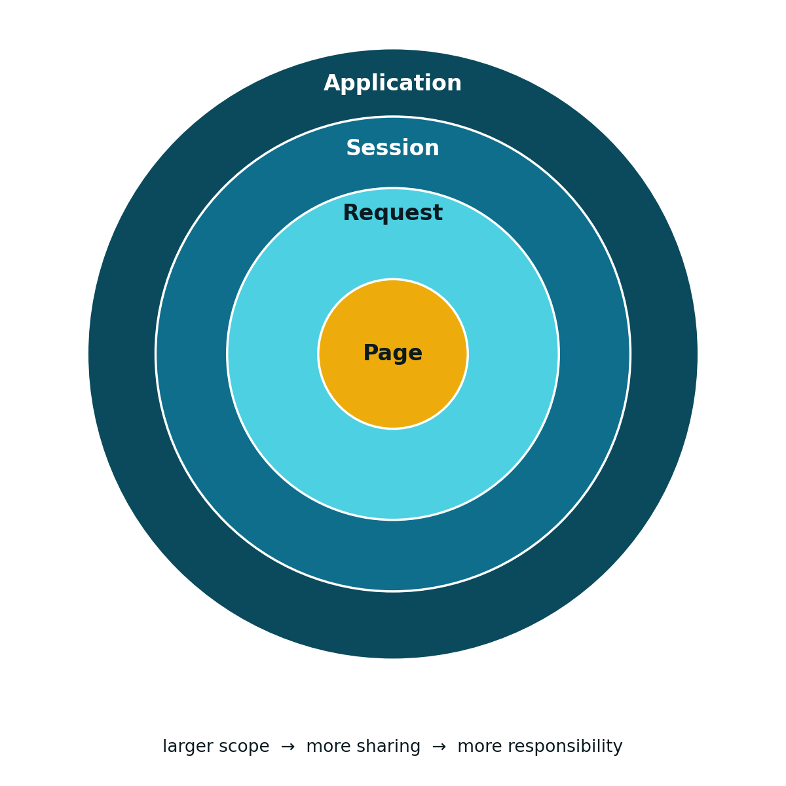

## HTTP Is Stateless: the Problem {#sec-05-state-problem-en}

The HTTP protocol is *stateless* (see [Chapter 3](cap03.qmd)): each request is independent, and the server does not, by itself, keep any memory of previous requests. At protocol level, there is no notion of a "logged-in user".

This raises an immediate practical problem: if a user authenticates in one request, how does a following request, minutes later, know that this user is still authenticated? The answer involves two complementary mechanisms:

- ***Cookies***: a small piece of information stored on the **client** side, automatically sent back by the *browser* with each following request
- **`HttpSession`**: an object stored on the **server** side, associated with an identifier that the client sends back with each request

## *Cookies* {#sec-05-cookies-en}

A *cookie* is a key/value pair stored in the *browser*. When the server sends a *cookie*, it expects the client to send it back in all the following HTTP requests to the same domain, thus implementing an identification mechanism that works around the *stateless* nature of HTTP.

There are two types, depending on how long they last:

- **_Session cookies_**: kept by the client only during a browsing session (`setMaxAge(-1)`). Until the session is closed, the client keeps identifying itself through the *cookie*. Once the session is closed (by *logout* or by closing the *browser*), the *cookie* is destroyed.
- **_Permanent cookies_**: stored persistently, with a defined lifetime (`setMaxAge(60*60*24*30)`: the time is expressed in seconds, in this case 30 days).

Creating a *cookie*:

```java
Cookie cookie = new Cookie("tema", "escuro");
cookie.setMaxAge(60 * 60 * 24 * 30); // permanent cookie: 30 days
response.addCookie(cookie);          // the cookie is added to the response and sent to the client
```

Reading a *cookie* received in a request:

```java
Cookie[] cookies = request.getCookies();
String tema = null;

if (cookies != null) {                       // null if the request carries no cookies
    for (Cookie c : cookies) {
        if (c.getName().equals("tema")) {
            tema = c.getValue();
        }
    }
}
```

The `getCookies()` method returns `null`, not an empty array, when the request carries no *cookie*, so the `cookies != null` check is mandatory.

## Sessions (`HttpSession`) {#sec-05-http-sessions-en}

Keeping state on the server side requires an object of its own: the `HttpSession`. The essential difference from a *cookie* lies in where the data is kept (@fig-05-cookie-vs-session-en): the *browser* keeps only an identifier, and it is the server that keeps, associated with that identifier, all the session data. The data never leaves the server, and the client can neither read nor change it.

{#fig-05-cookie-vs-session-en width="90%"}

A session is obtained, or created, from the request:

```java
HttpSession session = request.getSession();          // creates one if it does not exist
HttpSession session = request.getSession(true);      // equivalent, explicit
HttpSession session = request.getSession(false);     // NEVER creates; returns null if there is none
```

Once obtained, the session stores and returns information through attributes, and can be ended explicitly:

```java
session.setAttribute("email", "foo@fool.com");
String email = (String) session.getAttribute("email");
session.invalidate();                    // ends the session
session.setMaxInactiveInterval(1800);     // inactivity time, in seconds
session.getId();                          // session identifier (the JSESSIONID)
session.getAttributeNames();              // names of all the stored attributes
```

One piece is missing: if HTTP has no memory of previous requests, how does the server know that two successive requests belong to the same session? The answer is, again, *cookies*: by convention, the session identifier travels in a *cookie* called `JSESSIONID`, created automatically by the *Servlet Container* on the first call to `getSession()`.

::: {.httpmsg}
JSESSIONID=22562577CE80EF3B1DAAA0E48F2B6392
:::

@fig-05-jsessionid-en shows the complete mechanism, step by step:

1. The *browser* sends the credentials (`POST /login`). It does not yet have any *cookie* from this server.
2. The *Servlet* calls `getSession()`, the container creates a new session with a unique identifier, and the response carries the header `Set-Cookie: JSESSIONID=...`.
3. In a following request (`GET /perfil`), the *browser* automatically sends the *cookie* back in the `Cookie` header. The container uses the identifier to find the right session among all those it keeps.
4. The *Servlet* reads the attributes of that session and answers with that user's data.

{#fig-05-jsessionid-en width="90%"}

When the client does not accept *cookies*, there is an alternative: encoding the session identifier directly in the *URL*.

::: {.httpmsg}
http://localhost:8080/loja/perfil;jsessionid=829F8836C240B51DD2F074259F242833
:::

It is good practice to always call `response.encodeURL(url)` when building a destination *URL*: if *cookies* are enabled, the method returns the *URL* unchanged; if they are not, it automatically adds the `jsessionid`.

## Session-Based Authentication {#sec-05-session-authentication-en}

Putting the two previous mechanisms together gives the classic session-based authentication pattern. After validating the credentials, the `LoginServlet` creates a session and stores the user's identifier in it:

```java
@WebServlet("/login")
public class LoginServlet extends HttpServlet {
    protected void doPost(HttpServletRequest request, HttpServletResponse response)
            throws ServletException, IOException {
        String utilizador = request.getParameter("utilizador");
        String palavraPasse = request.getParameter("palavra-passe");

        if (dao.validarCredenciais(utilizador, palavraPasse)) {
            HttpSession session = request.getSession(true);
            session.setAttribute("utilizador", utilizador);

            response.setContentType("text/plain; charset=UTF-8");
            response.getWriter().print("Bem-vindo, " + utilizador);
        } else {
            response.setStatus(HttpServletResponse.SC_UNAUTHORIZED);
            response.setContentType("text/plain; charset=UTF-8");
            response.getWriter().print("Utilizador ou palavra-passe inválidos");
        }
    }
}
```

Note that `dao` is an instance of a *Data Access Object* (DAO), the object dedicated to data access already mentioned in [Chapter 4](cap04.qmd) (for example, a `UtilizadorDAO`). In this case, it is responsible for validating the credentials received: it typically queries a user database and returns `true` or `false` depending on whether the user/password pair is valid.

Any protected *endpoint* checks, at the start of its own `doGet()` or `doPost()`, whether there is a valid session with that attribute:

```java
HttpSession session = request.getSession(false);
if (session == null || session.getAttribute("utilizador") == null) {
    response.setStatus(HttpServletResponse.SC_UNAUTHORIZED);
    response.getWriter().print("Autenticação necessária");
    return;
}
// authenticated request: carry on with normal processing
```

Logging out simply means ending the session:

```java
session.invalidate();
```

## The MVC Pattern with *Servlet* and JSP {#sec-05-mvc-jsp-en}

[Chapter 1](cap01.qmd) presented the MVC pattern at a conceptual level, and [Chapter 4](cap04.qmd) showed how a *Servlet* works as a Controller. The pages built in [Chapter 2](cap02.qmd) already play the role of View, but they are static: their content does not change with the request. This section shows an alternative way of building the View, this time generated dynamically on the server side, from the data the Controller hands it.

{#fig-05-mvc-general-en width="55%"}

In a presentation-oriented application, the *Servlet* receives the request and decides **what** to show, but delegates the actual **generation of the HTML** to a [*JavaServer Page*](https://jakarta.ee/specifications/pages/) (JSP). The Model, in turn, is an ordinary Java class (for example, a *DAO*), independent of both.

The *Servlet* is linked to the JSP through a `RequestDispatcher`: it places the data to show in a request attribute, and forwards the request itself to the page:

```java
request.setAttribute("utilizador", utilizador);
request.getRequestDispatcher("/perfil.jsp").forward(request, response);
```

A *forward* is an internal hand-over: the *Servlet* passes the request to another component of the same server, without sending it back to the *browser*. The complete path of a request is shown in @fig-05-servlet-jsp-en:

1. The *browser* requests `GET /perfil` and the request reaches the *Servlet*.
2. The *Servlet* obtains the data (through the DAO) and stores it in the request, with `request.setAttribute(...)`.
3. The *Servlet* hands `perfil.jsp` the same `request` object and the same `response` object it received.
4. The JSP reads the data from the `request` and writes the HTML into the `response`.
5. The *browser* receives a single response, and the address bar still shows `/perfil`.

Everything happens inside the server: there is a single HTTP request, and the *browser* never knows the JSP existed. That is why the attributes placed in the request by the *Servlet* are still available in the JSP: both components work on the same `request` object.

{#fig-05-servlet-jsp-en width="90%"}

A JSP is a text document that mixes two kinds of content: static HTML and dynamic *script* elements. The first time it is requested, the *Servlet Container* automatically converts it into a *Servlet* class, which from then on behaves exactly like any other *Servlet*, in the role of `Controller`.

## A Simple JSP Example {#sec-05-jsp-example-en}

```jsp
<%@ page language="java" contentType="text/html; charset=UTF-8" pageEncoding="UTF-8"%>

<% String utilizador = (String) request.getAttribute("utilizador"); %>

<!DOCTYPE html>
<html>
<head>
  <meta http-equiv="Content-Type" content="text/html; charset=UTF-8">
  <title>Uma Página JSP</title>
</head>
<body>
  <h1>Olá, <%= utilizador %>!</h1>
</body>
</html>
```

The `<% ... %>` block (*scriptlet*) contains arbitrary Java code; the `<%= ... %>` block (expression) inserts the value of a Java expression directly into the generated HTML. It is precisely the `utilizador` attribute, placed in the request by the *Servlet* through `request.setAttribute(...)`, that the JSP retrieves here.

::: {.callout-tip}
## *Expression Language* (EL)

*Scriptlets* are now considered old practice, because they mix Java code with HTML. In current JSPs, the same line is written with the *Expression Language*, which looks up the attribute by name in the various *scopes* (see @sec-05-scopes-en), from the narrowest to the broadest:

```jsp
<h1>Olá, ${utilizador}!</h1>
```
:::

## Life Cycle and Implicit Objects {#sec-05-jsp-lifecycle-en}

The life cycle of a JSP follows the same model as the *Servlet* it is converted into (see [Chapter 4](cap04.qmd)), with two details of its own:

- The container automatically recompiles the JSP whenever the `.jsp` file is changed
- Instead of `init()` and `destroy()`, the JSP offers the `jspInit()` and `jspDestroy()` methods

Another practical difference: inside a JSP, a set of objects is automatically available, without any prior declaration; they are called implicit objects:

| Implicit object | Type |
|---|---|
| `out` | `JspWriter` |
| `request` | `HttpServletRequest` |
| `response` | `HttpServletResponse` |
| `session` | `HttpSession` |
| `application` | `ServletContext` |
| `page` | `Object` |

Because of the implicit `out` object, a JSP never needs to obtain a `PrintWriter` explicitly: `out` is used directly. Likewise, `request`, `session` and `application` give direct access to the three *scopes* described next.

## *Scopes*: Sharing Information Inside the Server {#sec-05-scopes-en}

Just as *Servlets* can share information with other modules through attributes (see [Chapter 4](cap04.qmd)), those attributes always exist within a given *scope*. There are four kinds of *scope*:

- ***Web context*** (or *application context*): the data is seen by the whole application, in every request from every user (for example, the address of the database)
- ***Session***: the data belongs to one user and is kept across that user's requests (for example, who logged in)
- ***Request***: the data exists only during one request and is lost as soon as the response is sent (for example, the data the *Servlet* passes to the JSP)
- ***Page***: exclusive to JSP, not used in this course

All *scopes* follow the same interface: `setAttribute`/`getAttribute` methods, and `getAttributeNames()` to list everything stored there.

**Web context**, shared by the whole application:

```java
ServletContext context = request.getServletContext();
context.setAttribute("dbHost", "localhost");
String dbHost = (String) context.getAttribute("dbHost");
```

**Session**, already presented, shared only by the same user:

```java
HttpSession session = request.getSession();
session.setAttribute("email", "foo@fool.com");
String email = (String) session.getAttribute("email");
```

**Request**, the narrowest of all, shared only between modules that process the same request (for example, between a *Servlet* and the JSP it forwards to):

```java
request.setAttribute("email", "foo@fool.com");
String email = (String) request.getAttribute("email");
```

The four *scopes* form a containment hierarchy, from the broadest to the narrowest: *Application* contains *Session*, which contains *Request*, which contains *Page*. The larger the *scope*, the more widely the information is shared, and the greater the responsibility for managing it correctly (for example, removing it when it is no longer needed).

{#fig-05-scopes-comparison-en width="60%"}

::: {.callout-note}
## *Scopes* are not instantiated

The *scope* objects (`ServletContext`, `HttpSession`, `ServletRequest`) are provided automatically by the container. A new instance is never created with `new`: they are obtained from the request. The `getServletContext()` method always returns the same context, which exists while the application is running; the `getSession()` method returns the existing session or, if there is none yet, creates a new one.
:::
