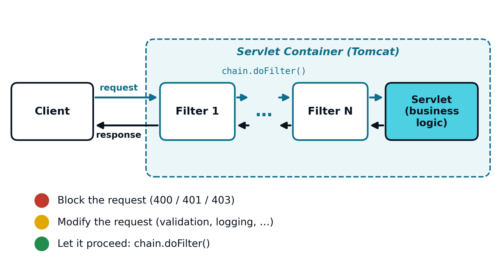
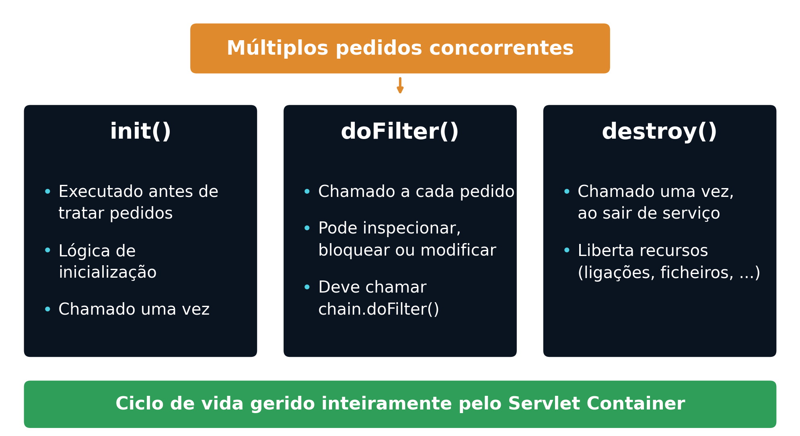
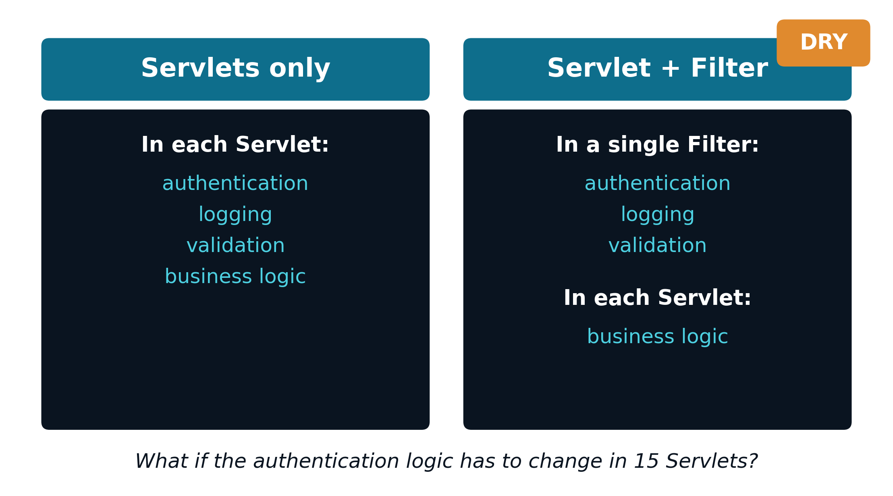

## The Problem: Security Repeated in Every *Servlet* {#sec-06-problem-en}

With what has been presented so far (see [Chapter 5](cap05.qmd)), authentication is solved: the `LoginServlet` validates the credentials and stores the user in the session, and each protected *endpoint* checks that session at the start of its `doGet()` or `doPost()`. This works, but it has a hidden cost: the authentication logic lives, duplicated, inside **each** protected *Servlet*.

This duplication brings several problems:

- The same session check is repeated in every protected *endpoint*
- There is a real risk of inconsistency between those copies
- It is easy to forget the protection when creating a new *endpoint*

In other words, this duplication violates the *DRY* principle (*Don't Repeat Yourself*): a responsibility should live in a single place, and repeated logic increases the maintenance cost whenever that logic needs to change. More precisely, this design violates the **Single Responsibility Principle**: each *Servlet* ends up with two distinct responsibilities, its own business logic and the security logic imposed on it. This makes security policies hard to evolve, and the design poorly scalable, both in number of *endpoints* and in the complexity of the access rules.

## Authentication vs. Authorisation {#sec-06-authentication-authorisation-en}

Before solving the problem, it is worth clarifying two concepts that are often confused:

**Authentication**
: Answers "who is the user?". It is the identity check, typically done at *login* time.

```java
if (dao.validarCredenciais(utilizador, palavraPasse)) {
    HttpSession session = request.getSession(true);
    session.setAttribute("utilizador", utilizador);
}
```

**Authorisation**
: Answers "what is this user allowed to access?". It is the permission check, done after the identity has been confirmed.

```java
if ("admin".equals(session.getAttribute("perfil"))) {
    // access allowed
}
```

In this example, the *login* stored in the session, besides the user, their profile (for example, `"admin"`), and only users with that profile have access to the resource.

Authentication always comes first: it makes no sense to check the permissions of someone whose identity has not yet been confirmed. This distinction is directly reflected in the HTTP status codes used in the response (see [Chapter 3](cap03.qmd)):

- `401 Unauthorized`: the request is not authenticated
- `403 Forbidden`: the request is authenticated, but has no permission for the requested resource

## What Is a Filter {#sec-06-what-is-a-filter-en}

The question still to answer is where the security logic should live: inside each *Servlet*? Duplicated across all *endpoints*? Or centralised in a single component? Security is, by nature, a *cross-cutting concern*: it runs through the whole application, instead of belonging to a single module. This is exactly what the Filter exists for.

A [Filter](https://jakarta.ee/specifications/servlet/) is a server-side component that intercepts HTTP requests:

- It runs **before** the target *Servlet*
- It can also run **after** the *Servlet* (on the response)
- It can block, redirect or modify the request or the response

Besides authentication and authorisation, Filters are the natural mechanism for other cross-cutting concerns: activity logging, *CORS* (*Cross-Origin Resource Sharing*), or input validation. A Filter separates these concerns from the business logic, which stays exclusively in the *Servlet*.

## Where a Filter Sits in the Request {#sec-06-where-a-filter-sits-en}

One or more Filters can be chained between the client and the *Servlet* that actually handles the request. The request goes through the Filters in the order of the chain and only then reaches the *Servlet*, where the business logic lives; the response follows the reverse path, back to the client.

{#fig-06-filter-chain-en width="80%"}

Each Filter in the chain has, essentially, three possible behaviours:

- **Block the request**: for example, `400` (invalid data), `401` (invalid identity) or `403` (authenticated but without permission)
- **Modify the request**: data normalisation and validation, activity logging, among others
- **Let it proceed**: by calling `chain.doFilter(request, response)`, passing control to the next element in the chain

Consider an application with an authentication Filter in front of the *Servlet* that shows the user's profile, mapped to `/perfil`. The path of a request is this:

1. The *browser* sends `GET /perfil`.
2. Before the request reaches the *Servlet*, the container hands it to the Filter, which looks for the session with `getSession(false)` and, inside it, the `utilizador` attribute.
3. **No session** (the user has not logged in yet): the Filter answers `401` and the request ends there. The *Servlet* never runs.
4. **With a session**: the Filter calls `chain.doFilter(request, response)` and the request goes on to the *Servlet*, which produces the profile page.
5. The *Servlet*'s response passes through the Filter again, on its way to the *browser*.

## The Life Cycle of a Filter {#sec-06-filter-lifecycle-en}

The life cycle of a Filter follows the same model already presented for *Servlets* (see [Chapter 4](cap04.qmd)):

- `init()`: runs only once, when the container puts the Filter into service
- `doFilter()`: runs on each request; it can inspect, block or modify the request and the response, and must call `chain.doFilter()` to continue the chain; it can also run code after `chain.doFilter()` returns, with the response already produced by the *Servlet*
- `destroy()`: runs only once, when the Filter is taken out of service, to release resources

Like a *Servlet*, there is **a single instance** of each Filter, shared by multiple concurrent requests: exactly the same care already mentioned in [Chapter 4](cap04.qmd) applies here, avoid shared mutable state and prefer local variables inside `doFilter()`.

{#fig-06-filter-lifecycle-en width="85%"}

## *Servlet* and Filter: Separation of Responsibilities {#sec-06-separation-of-responsibilities-en}

Centralising security in a Filter reorganises the responsibilities of the whole application:

{#fig-06-servlet-vs-filter-en width="75%"}

This reorganisation brings concrete advantages:

- The authentication logic is written **only once** (*DRY* principle)
- The security policy is applied consistently to all *endpoints*
- There is no longer a risk of "forgetting" the protection in a new *Servlet*
- The separation between cross-cutting concerns (Filter) and business logic (*Servlet*) becomes clear

## Declaring and Implementing a Filter {#sec-06-declaring-a-filter-en}

A Filter is declared with the `@WebFilter` annotation, indicating the *URL* pattern it applies to:

```java
@WebFilter("/*")
public class AuthenticationFilter implements Filter {
    // ...
}
```

The `"/*"` pattern intercepts all requests, without exception. The class must implement `jakarta.servlet.Filter`, and the container discovers it automatically at *deployment* time. Like *Servlets*, a Filter can also be declared equivalently in the `web.xml` file, although this practice is no longer widely used.

A typical `doFilter()`, which protects all requests by requiring a valid session, looks like this:

```java
public void doFilter(ServletRequest request,
                      ServletResponse response,
                      FilterChain chain)
        throws IOException, ServletException {

    HttpServletRequest req = (HttpServletRequest) request;
    HttpServletResponse res = (HttpServletResponse) response;

    HttpSession session = req.getSession(false);

    if (session == null || session.getAttribute("utilizador") == null) {
        res.sendError(HttpServletResponse.SC_UNAUTHORIZED); // 401
        return;
    }

    chain.doFilter(request, response);
}
```

In practice, not all requests should be protected: `/login` itself, and static resources such as `/css`, `/js` or `/images`, must remain accessible without authentication, otherwise the user could never even reach the *login* form. The complete version of `doFilter()` handles these exceptions first and only then checks the session:

```java
public void doFilter(ServletRequest request,
                      ServletResponse response,
                      FilterChain chain)
        throws IOException, ServletException {

    HttpServletRequest req = (HttpServletRequest) request;
    HttpServletResponse res = (HttpServletResponse) response;

    String ctx = req.getContextPath();   // e.g. "/MinhaApp"
    String path = req.getRequestURI();   // e.g. "/MinhaApp/css/estilo.css"

    boolean isLogin = path.endsWith("/login");
    boolean isStatic = path.startsWith(ctx + "/css")
                     || path.startsWith(ctx + "/js")
                     || path.startsWith(ctx + "/images");

    if (isLogin || isStatic) {           // public resources
        chain.doFilter(request, response);
        return;
    }

    HttpSession session = req.getSession(false);

    if (session == null || session.getAttribute("utilizador") == null) {
        res.sendError(HttpServletResponse.SC_UNAUTHORIZED); // 401
        return;
    }

    chain.doFilter(request, response);
}
```

The `getContextPath()` method returns the prefix under which the application is installed on the server, and `getRequestURI()` returns the full requested path. Comparing the start of the path with `ctx + "/css"` works whatever the name under which the application was installed.

Everything a Filter does after `chain.doFilter()` returns happens with the response already produced by the *Servlet*. An activity logging Filter, for example, notes the time before passing the request to the chain and computes the duration when the chain returns:

```java
@WebFilter("/*")
public class RegistoFilter implements Filter {

    public void doFilter(ServletRequest request,
                          ServletResponse response,
                          FilterChain chain)
            throws IOException, ServletException {

        long inicio = System.currentTimeMillis();   // before the Servlet

        chain.doFilter(request, response);          // the Servlet runs here

        long duracao = System.currentTimeMillis() - inicio;   // after
        HttpServletRequest req = (HttpServletRequest) request;
        System.out.println(req.getRequestURI() + ": " + duracao + " ms");
    }
}
```

The `inicio` and `duracao` variables are local: each request has its own, and concurrent requests do not interfere with one another, as recommended in the life cycle.

## Redirect vs. `401`: an Architectural Difference {#sec-06-redirect-vs-401-en}

The right way to react to an authentication failure depends on the type of application:

- In a traditional, presentation-oriented Web application (see [Chapter 1](cap01.qmd)), the natural response is a **redirect** to the *login* page (code `302`)
- In a REST API, whose contract is JSON (see [Chapters 7](cap07.qmd) and [8](cap08.qmd)), the right response is to return **`401`**, without any redirect

The difference boils down to one sentence: in a traditional Web application, an authentication failure changes the page shown; in a REST API, it changes only the status code returned. It is the client, not the server, that decides what to do next with that `401`.

## Preparing for Stateless Security {#sec-06-preparing-for-stateless-en}

The model presented in this chapter relies entirely on the session: the server keeps the authenticated user's state (`HttpSession`), and the Filter checks that session on every request. This model has a limitation: it requires the server to keep a memory of each user, which becomes a problem as soon as there is more than one server handling requests (see [Chapter 7](cap07.qmd)).

The alternative is *token*-based authentication: instead of the server keeping any session, the request itself carries, on every call, all the information needed to authenticate itself. This change, from a *stateful* model to a *stateless* model, is the subject of the following chapters.
