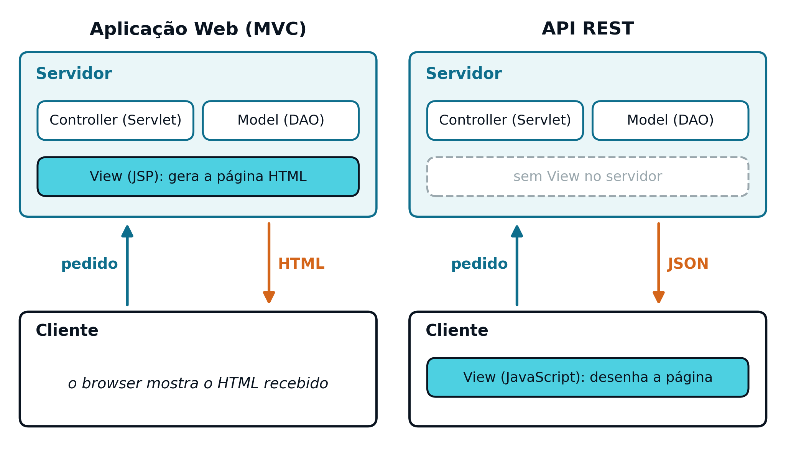
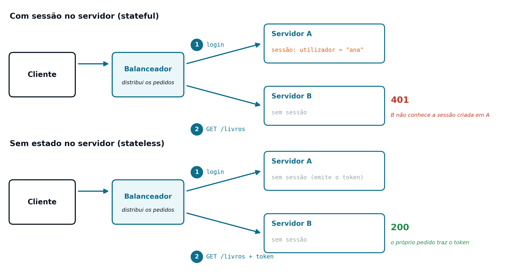

## The Problem: Applications That Need to Communicate {#sec-07-problem-en}

So far, the server has always been thought of from the perspective of a single type of client: a *browser*, asking for HTML pages for a human user to read. But a server rarely serves only that type of client. A mobile application, another server, an integration *script*, or the JavaScript running in the *browser* itself (see [Chapter 8](cap08.qmd)) may also need to access the same information, without any of them needing, or wanting, to receive an HTML page ready to display.

HTML is a format designed for presentation: it mixes the data with the structure and with the way that data should be shown. A program that only needs the data (for example, the title and author of a book) would have to "take apart" the HTML to get to it, which is fragile and depends on presentation details that have nothing to do with the information itself. What is needed is a way of exposing the same data so that any program, and not only a *browser* with a human looking at it, can consume it directly.

## What Is a *Web Service* {#sec-07-webservice-en}

A *Web Service* is a *software* component accessible over the network, typically via HTTP, that exposes functionality or data in a format designed to be consumed by other programs, not by a human reading directly. Unlike a *Web* page, a *Web Service* does not generate presentation: it returns only the data, organised in a known structure, and it is the client that decides what to do with it.

This decoupling is what allows the same server to answer, with the same logic, requests coming from completely different sources: a mobile application, a JavaScript *front-office*, or another server. They all receive the same data, in the same structure, and each one decides how to present it (or whether to present it at all).

## SOAP and REST: Two Approaches {#sec-07-soap-rest-en}

Historically, there have been two main approaches to building *Web Services*:

**SOAP** (*Simple Object Access Protocol*)
: A formal, XML-based protocol, with a rigid message structure (the SOAP *envelope*) and a contract described separately, in a *WSDL* document. It is verbose and requires specific tools to generate and consume that contract, but it offers strong formal guarantees. It is used mainly in legacy enterprise systems, with strict transaction and security requirements.

**REST** (*Representational State Transfer*)
: An architectural style, not a formal protocol, that uses HTTP directly as transport and as contract: the methods, status codes and headers already presented in [Chapters 3](cap03.qmd) and [4](cap04.qmd) are themselves the vocabulary of the API. It is lighter and simpler to test, and it is today the dominant approach in *Web* and mobile applications. It is the only one covered in detail in this course.

## REST: Fielding's Principles {#sec-07-rest-principles-en}

The term REST was coined by Roy Fielding, in 2000, to describe the architectural style that was already, in practice, implicit in the design of the *Web* itself. A REST service follows a set of principles:

- **Client-server**: responsibilities are separated; the client does not need to know how the data is stored, and the server does not need to know how it is presented.
- **Stateless**: each request contains all the information needed to process it, without depending on memory of previous requests on the server (see @sec-07-stateful-stateless-en).
- **Uniform interface**: resources are always manipulated in the same way, through HTTP's own methods and status codes, without inventing a vocabulary of its own for each API.
- **Resources and representations**: everything the API exposes is modelled as a resource, identified by a *URL*, with one or more possible representations (typically JSON).
- **Cacheable**: a response can indicate whether or not it may be cached, to avoid unnecessary repeated requests.

Not all APIs that call themselves "REST" respect all these principles rigorously. In practice, "REST" has become a generic term for "API over HTTP, resource-oriented, typically with JSON", and that is the meaning used throughout this course.

## Resource-Oriented Architecture {#sec-07-resources-en}

The most visible principle of REST is to think of the API in terms of **resources**, not actions. A resource is anything that can be identified and manipulated (a book, an author, an order) and is identified by a *URL*, never by a function name.

A design that does not follow this principle is closer to an *RPC* (*Remote Procedure Call*) style, in which the *URL* names an operation:

::: {.httpmsg}
GET /obterLivro?id=12\
GET /removerLivro?id=12
:::

A resource-oriented design uses the *URL* itself to identify the resource, and lets the HTTP method (see [Chapter 3](cap03.qmd)) indicate the operation to perform on it:

::: {.httpmsg}
GET /livros/12 → get book 12\
DELETE /livros/12 → remove book 12
:::

The advantage is not merely aesthetic: it makes the API predictable. Once the `/livros/{id}` pattern is known, it is immediately clear how to get, update or remove any book, without having to memorise a different function name for each operation. The same pattern applies to any other resource: `/autores/3`, `/encomendas/5`.

## HTTP Methods as the API Contract {#sec-07-methods-contract-en}

In a REST API, HTTP methods are no longer just "the way the request arrives" (see [Chapter 3](cap03.qmd)) and become the API contract itself: the meaning of each method, applied to a resource, is always the same.

| Method | Example | Operation | Idempotent? |
|---|---|---|---|
| `GET` | `GET /livros/12` | Read the resource | Yes |
| `POST` | `POST /livros` | Create a new resource | No |
| `PUT` | `PUT /livros/12` | Update or replace the resource | Yes |
| `DELETE` | `DELETE /livros/12` | Remove the resource | Yes |

A method is said to be **idempotent** when repeating it several times has exactly the same effect as executing it once. `DELETE /livros/12` removes book 12; repeating the same request does not remove "anything else", and the end result is identical. `POST /livros`, on the other hand, creates a new book on each call, so it is not idempotent: repeating the request creates several books, not just one. This property matters above all on unreliable networks. A client that is not sure whether a `PUT` or `DELETE` request reached its destination can safely repeat it; with a `POST` it cannot, or it risks duplicating the created resource.

::: {.callout-note}
## `POST` + `operation` as an alternative to "pure" HTTP methods

In practice, it is common to find APIs that do not follow the "pure" semantics of the HTTP methods presented above (`POST` to create, `PUT` to update, `DELETE` to remove). A pragmatic alternative, used mainly when only `GET` and `POST` requests can be issued (as from a plain HTML form, without JavaScript, see [Chapter 2](cap02.qmd)), is to concentrate the write operations in a single *endpoint*, always received by `POST`, and to distinguish the intended operation through an additional parameter, such as `operation` (`insert`, `update`, `delete`).

This solution works, but it departs from the more conventional REST design: a single *endpoint* no longer corresponds directly to a resource and a method, and gets closer to an *RPC* style over HTTP. In an API designed to be consumed by JavaScript, which can issue `PUT` and `DELETE` requests without any limitation (see [Chapter 8](cap08.qmd)), the alternative closest to REST is to split that *endpoint* into several, one per HTTP method (for example, `PUT /livros/{id}` to update and `DELETE /livros/{id}` to remove).
:::

## The REST Contract: HTTP Semantics {#sec-07-http-contract-en}

In SOAP, the contract is explicit: to know how to call a service, one has to read the *WSDL* document that describes it. In REST, the contract is implicit: it is already defined by HTTP itself, complemented by a few conventions. Besides the methods, two parts of HTTP belong to this contract:

- **Status codes** tell the client what happened to the request, without having to read the response body.
- **Headers** carry the metadata: the body format (`Content-Type`), its size, or the identification of who is making the request.

The status codes most used in a REST API are these (see [Chapter 3](cap03.qmd)):

| Code | Meaning in a REST API | Example |
|---|---|---|
| `200 OK` | The request went well; the body carries the result | `GET /livros/12` |
| `201 Created` | The resource was created | `POST /livros` |
| `400 Bad Request` | The data sent is invalid | `POST /livros` without a title |
| `401 Unauthorized` | The request is not authenticated | any protected request, without authentication |
| `404 Not Found` | The resource does not exist | `GET /livros/99`, if there is no book 99 |

A client asking for a book that does not exist sends this request:

::: {.httpmsg}
GET /livros/99 HTTP/1.1\
Host: exemplo.pt
:::

and receives a response whose meaning is clear from the first line alone:

::: {.httpmsg}
HTTP/1.1 404 Not Found
:::

Whoever understands HTTP understands the API: the same knowledge works for any REST API, without having to learn a new contract for each one.

## JSON as the Representation of a Resource {#sec-07-json-representation-en}

A resource can have more than one possible representation: the same book could, in theory, be returned in JSON, in XML, or in any other format, depending on what the client asks for. In practice, and throughout this course, the representation used is always [JSON](https://www.json.org/), a lightweight, easy-to-read format, independent of the programming language (the format traditionally associated with SOAP is XML, more verbose and less direct to generate and interpret in JavaScript).

The response to `GET /livros/12` is, for example, this representation of the book:

```json
{"id": 12, "titulo": "Os Maias", "autor": "Eça de Queirós"}
```

The `Content-Type: application/json` header (see [Chapter 4](cap04.qmd)) is what informs the client that this is the representation chosen for the response. In a REST API, neither objects nor pages are transferred, but representations of the state of each resource.

## From a Web Application to a REST Service {#sec-07-web-to-rest-en}

The infrastructure behind a REST service is not new: it is still a *Servlet*, mapped to a *URL* through `@WebServlet` (see [Chapter 4](cap04.qmd)), receiving an HTTP request and returning a response. What changes is **what** that response contains, and **who** it is meant for.

In a presentation-oriented application (see [Chapters 1](cap01.qmd) and [5](cap05.qmd)), the *Servlet* returns HTML, meant for a human to read directly in the *browser*. In a REST API, the same *Servlet* returns JSON, meant to be interpreted by code: another server, a mobile application, or the *browser*'s own JavaScript (see [Chapter 8](cap08.qmd)). The *View*, in the classic MVC sense (see [Chapter 1](cap01.qmd)), no longer exists on the server side: it is the client, whatever it is, that decides how (or whether) to present the data received.

{#fig-07-mvc-vs-rest-en width="90%"}

## *Stateful* vs. *Stateless* {#sec-07-stateful-stateless-en}

[Chapter 5](cap05.qmd) presented a *stateful* model: the server keeps, in the `HttpSession`, information about each authenticated user, and each following request is interpreted in the light of that memory. A **stateless** service follows the opposite principle: the server keeps no memory at all between requests, and each request must carry, in itself, all the information needed to process it, including, if necessary, the proof that whoever makes it is authenticated.

This does not mean that the application as a whole stops having persistent data: the database still keeps books, authors and orders. It only means that the **application server** itself keeps no session information about who is making each request, between one request and the next.

## Why the Absence of State Matters {#sec-07-why-stateless-matters-en}

The limitation of the stateful model only becomes visible when there is more than one server handling requests (several Tomcats, each with the same application installed; not to be confused with instances of a *Servlet*, of which there is always only one per Tomcat, see [Chapter 4](cap04.qmd)), a common situation in any application with a real need to scale. Requests first reach a **load balancer**, which distributes them among the various servers. The path of two consecutive requests shows where the problem lies:

1. The user logs in; the load balancer sends the request to server A, which creates the session in its memory.
2. The next request, `GET /livros`, is sent by the load balancer to server B.
3. Server B has no corresponding session in its memory: the user appears as not authenticated (`401`), despite having just logged in.

{#fig-07-instances-en width="95%"}

A stateless service does not suffer from this problem: since no server keeps a memory of anyone, any of them can answer any request. This property is what makes it possible to distribute requests among several servers without any coordination between them, a subject taken up in detail in [Chapter 8](cap08.qmd).

## Monolith and Microservices {#sec-07-monolith-microservices-en}

The absence of state has consequences for the way an application is organised. In a **monolith**, the application is a single unit of deployment, often stateful (the session lives in the server's memory), and it can only be scaled as a whole. In a **microservices** architecture, the application is split into small, independent services, which communicate with each other through REST APIs, without state and with *token* authentication, and each one can scale on its own. The absence of state is what makes it possible to spread an application across several servers and several services.

## REST and RESTful {#sec-07-rest-restful-en}

**REST** is an architectural style: stateless, resource-oriented and with a uniform interface. A **RESTful API** is an API that claims to follow that style. Since the absence of state is part of the very definition of REST, an API that keeps the user's session on the server is not fully RESTful.

One question is therefore left open: if the server keeps no state at all, how does it know, on each request, who the user is? The answer, *token* authentication, is the subject of [Chapter 8](cap08.qmd).
